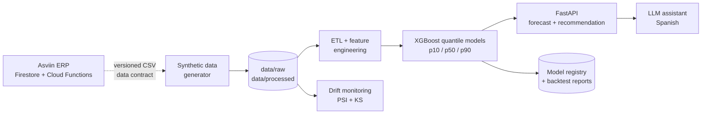

# Asviin ML Forecasting

> AI/MLOps extension of **Asviin**, a real ERP for SME plastic recyclers and
> transformers in Mexico: probabilistic demand forecasting and inventory
> recommendations on top of the ERP's sales and stock data.

[](https://www.python.org/downloads/release/python-3123/)
[](LICENSE)

**Milestone status:** M1–M2 — documentation, foundation and the reproducible
synthetic data pipeline are complete. Models, serving and monitoring land in
milestones M3–M6 (see the roadmap below); this README is updated as each
milestone is committed.

---

## The business problem

Asviin runs the commercial and inventory operations of multi-branch businesses in
Mexico: point-of-sale tickets, stock movements, recipes and bill-of-materials,
purchase orders, pending orders, promotions, returns and cancellations. The ERP
records what happened. It does **not** answer the forward-looking question every
branch manager asks each week:

> *How much of each product should I have on hand for the next delivery cycle?*

Today that decision is made with intuition, a spreadsheet average, or the last
week's sales. Both failure modes are expensive:

- **Stockouts** mean lost sales and rushed purchases at worse prices.
- **Overstock** immobilizes working capital, occupies shelf space and increases
  spoilage/obsolescence risk.

The underlying demand is genuinely hard to plan:

- Roughly **half of product-days have zero sales** in the reference dataset;
  many SKUs are intermittent or lumpy.
- Promotions pull demand forward; stockouts **censor** the demand that was never
  recorded.
- Branch volume profiles differ, and order lead times vary per supplier.
- Figures are in **MXN** and the business runs on **America/Mexico_City** time.

An average ignores all of this. A probabilistic forecast plus an explicit
service-level policy is the defensible way to decide.

## What this repository delivers

| Capability | Description |
|---|---|
| **Probabilistic demand forecast** | Daily demand per product × branch with `p10` / `p50` / `p90` intervals, so the planner can price uncertainty instead of ignoring it. |
| **Reorder recommendation** | Reorder point and order quantity from the forecast, safety stock, lead time and a target service level. |
| **Data drift monitoring** | PSI and two-sample KS tests comparing a reference window with current data, with explicit thresholds and a JSON report. |
| **Natural-language assistant** | A Spanish assistant that resolves a product, asks the forecasting API and answers *"¿cuánto debo pedir de X?"* with real numbers. |
| **Reproducible MLOps** | Synthetic dataset, pinned dependencies, tests, Docker image and CI pipeline. |

## Design principles

1. **Strictly decoupled from the ERP.** This repository never imports Asviin
   code or touches Firestore. The integration contract is a versioned CSV data
   contract that mirrors the ERP's real fields (`economicEvents`, `products`
   stock-by-branch, `pendingSales`, `movimientos`). The AI layer can evolve
   without risking the production ERP.
2. **Synthetic data by default.** Asviin V1 serves real paying clients; V2 runs
   in production with test data only. This portfolio repository ships a
   deterministic synthetic dataset that follows the real schema and business
   rules, so it is safe to publish and reproducible for every reviewer. No real
   client data, credentials or backups are included.
3. **Honest time-series evaluation.** Temporal holdouts only, no shuffled
   splits, no target leakage, and explicit baselines (seasonal naive and
   Croston/SBA for intermittent SKUs).
4. **Everything reproducible.** Fixed seeds, committed dataset and artifacts,
   Makefile targets, pinned requirements and CI.

## The synthetic dataset (M2)

The dataset is generated from the Asviin v2 schema and business rules: three years
of daily operations for a plastic recycler/transformer with 20 products, 3
branches, a bill-of-materials, promotions, pending orders and cancellations. It is
deterministic (seed 42), committed to the repository and safe to publish.

| Metric | Value |
|---|---|
| Period | 2023-01-01 → 2025-12-31 (1,096 days) |
| Branches / products | 3 / 20 (14 sellable, 6 ingredients, 5 with a recipe) |
| Modeling grain | product × branch × day = 60 series, 65,760 rows |
| Economic events / stock movements | 35,594 / 39,110 |
| Pending sales | 2,983 (≈9% of invoiced volume) |
| Zero-sale series-days | 55.3% — intermittent demand, realistic for SME retail |
| Stockout series-days | 2,039 — demand is censored, the model must learn from observables |

The ETL flattens Asviin's `economicEvents` and `movimientos` into
`data/processed/demand_daily.csv`: cancelled lines are excluded from sales,
missing days are zero-filled, and `pending_units`, closing `stock_on_hand`,
`promo` and `stockout_flag` are derived. Every run writes a data-quality report;
the full data dictionary and the Asviin→CSV mapping live in
[`docs/DATA_CONTRACT.md`](docs/DATA_CONTRACT.md).

```bash
make data        # regenerate raw + processed data (seed 42, deterministic)
make data-quick  # 120-day smoke dataset used by CI
```

## Target architecture



The ERP is deliberately shown as a dashed edge: in this repository the data
contract is the boundary. A private deployment can replace the synthetic source
with a read-only exporter without changing a line of the model or serving code.

## Repository layout (built milestone by milestone)

```text
asviin-ml-forecasting/
├── data/
│   ├── raw/                    # products, branches, recipes, events, movements, pending sales (M2)
│   └── processed/              # demand_daily.csv + data-quality report (M2)
├── notebooks/
│   ├── 01_eda.ipynb            # seasonality, ABC/XYZ, intermittency (M2)
│   ├── 02_modeling.ipynb       # backtest and model selection (M3)
│   └── 03_explainability.ipynb # SHAP / feature importance (M3)
├── src/
│   ├── api/                    # FastAPI serving layer (M4)
│   ├── agent/                  # natural-language assistant (M6)
│   ├── data_contracts/         # canonical schema + CSV validators (M1–M2)
│   ├── monitoring/             # PSI/KS drift checks (M5)
│   └── pipelines/              # synthetic generator, ETL, features, training (M2–M4)
├── tests/                      # unit + integration tests (M1–M6)
├── artifacts/                  # model registry, backtest and drift reports (M4–M5)
├── docs/                       # build spec, data contract, decisions, architecture (M1+)
├── Dockerfile                  # serving image (M5)
├── .github/workflows/ci.yml    # lint + tests + pipeline smoke (M5)
├── requirements.txt            # pinned runtime dependencies (M1)
├── requirements-dev.txt        # pinned development dependencies (M1)
├── pyproject.toml              # packaging and tooling (M1)
├── Makefile                    # reproducible commands (M1)
└── README.md
```

## Roadmap

| Milestone | Scope | Status |
|---|---|---|
| **M1** | Problem statement, requirements, packaging and repository structure | ✅ Committed |
| **M2** | Synthetic data generator faithful to the Asviin schema + EDA notebook | ✅ This commit |
| **M3** | Feature engineering, XGBoost/Prophet comparison and time-series validation | Next |
| **M3** | Feature engineering, XGBoost/Prophet comparison and time-series validation | Planned |
| **M4** | Training CLI and FastAPI service with model registry | Planned |
| **M5** | Docker, GitHub Actions and data-drift monitoring | Planned |
| **M6** | Natural-language LLM agent | Planned |

## Getting started

```bash
python3 -m venv .venv
.venv/bin/pip install -e ".[dev]"

make data   # regenerate the committed synthetic dataset (deterministic)
make test   # contract, generator and ETL tests

# inspect the modeling panel
head -3 data/processed/demand_daily.csv
```

Training and serving commands (`make train`, `make serve`) arrive in
milestones M3–M4.

## Tech stack

`Python 3.12` · `pandas` / `numpy` · `XGBoost` (quantile regression) ·
`FastAPI` / `Pydantic` · `PSI` + two-sample `KS` drift tests ·
`pytest` / `ruff` · `Docker` · `GitHub Actions`.

## Data & privacy

- The committed dataset is **fully synthetic**, generated from the Asviin v2
  schema and documented business rules (see `docs/SPEC.md`).
- Asviin V1 serves real clients; V2 runs in production with test data. This
  repository intentionally contains **zero real client data**.
- No credentials, `.env` files or service-account keys are committed.

## License

MIT — see [LICENSE](LICENSE).
