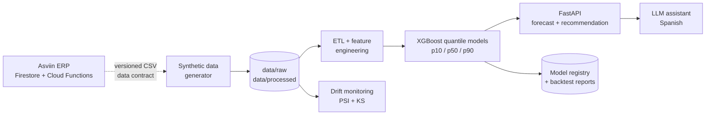

# Asviin ML Forecasting

> AI/MLOps extension of **Asviin**, a real ERP for SME plastic recyclers and
> transformers in Mexico: probabilistic demand forecasting and inventory
> recommendations on top of the ERP's sales and stock data.

[](https://www.python.org/downloads/release/python-3123/)
[](LICENSE)
[](https://github.com/llogaran/asviin-ml-forecasting/actions/workflows/ci.yml)

**Milestone status:** M1–M6 — the portfolio is complete: documentation, the
reproducible synthetic data pipeline, feature engineering, temporal-validation
modeling, the training CLI, the model registry, the FastAPI service, drift
monitoring, Docker/CI and the natural-language assistant. All milestones are
committed in order; see the roadmap below.

---

## The business problem

Asviin runs the commercial and inventory operations of multi-branch businesses in
Mexico: point-of-sale tickets, stock movements, recipes and bill-of-materials,
purchase orders, pending orders, promotions, returns and cancellations. The ERP
records what happened. It does **not** answer the forward-looking question every
branch manager asks each week:

> *How much of each product should I have on hand for the next delivery cycle?*

Today that decision is made with intuition, a spreadsheet average, or the last
week's sales. Both failure modes are expensive:

- **Stockouts** mean lost sales and rushed purchases at worse prices.
- **Overstock** immobilizes working capital, occupies shelf space and increases
  spoilage/obsolescence risk.

The underlying demand is genuinely hard to plan:

- Roughly **half of product-days have zero sales** in the reference dataset;
  many SKUs are intermittent or lumpy.
- Promotions pull demand forward; stockouts **censor** the demand that was never
  recorded.
- Branch volume profiles differ, and order lead times vary per supplier.
- Figures are in **MXN** and the business runs on **America/Mexico_City** time.

An average ignores all of this. A probabilistic forecast plus an explicit
service-level policy is the defensible way to decide.

## What this repository delivers

| Capability | Description |
|---|---|
| **Probabilistic demand forecast** | Daily demand per product × branch with `p10` / `p50` / `p90` intervals, so the planner can price uncertainty instead of ignoring it. |
| **Reorder recommendation** | Reorder point and order quantity from the forecast, safety stock, lead time and a target service level. |
| **Data drift monitoring** | PSI and two-sample KS tests comparing a reference window with current data, with explicit thresholds and a JSON report. |
| **Natural-language assistant** | A Spanish assistant that resolves a product, asks the forecasting API and answers *"¿cuánto debo pedir de X?"* with real numbers. |
| **Reproducible MLOps** | Synthetic dataset, pinned dependencies, tests, Docker image and CI pipeline. |

## Design principles

1. **Strictly decoupled from the ERP.** This repository never imports Asviin
   code or touches Firestore. The integration contract is a versioned CSV data
   contract that mirrors the ERP's real fields (`economicEvents`, `products`
   stock-by-branch, `pendingSales`, `movimientos`). The AI layer can evolve
   without risking the production ERP.
2. **Synthetic data by default.** Asviin V1 serves real paying clients; V2 runs
   in production with test data only. This portfolio repository ships a
   deterministic synthetic dataset that follows the real schema and business
   rules, so it is safe to publish and reproducible for every reviewer. No real
   client data, credentials or backups are included.
3. **Honest time-series evaluation.** Temporal holdouts only, no shuffled
   splits, no target leakage, and explicit baselines (seasonal naive and
   Croston/SBA for intermittent SKUs).
4. **Everything reproducible.** Fixed seeds, committed dataset and artifacts,
   Makefile targets, pinned requirements and CI.

## The synthetic dataset (M2)

The dataset is generated from the Asviin v2 schema and business rules: three years
of daily operations for a plastic recycler/transformer with 20 products, 3
branches, a bill-of-materials, promotions, pending orders and cancellations. It is
deterministic (seed 42), committed to the repository and safe to publish.

| Metric | Value |
|---|---|
| Period | 2023-01-01 → 2025-12-31 (1,096 days) |
| Branches / products | 3 / 20 (14 sellable, 6 ingredients, 5 with a recipe) |
| Modeling grain | product × branch × day = 60 series, 65,760 rows |
| Economic events / stock movements | 35,594 / 39,110 |
| Pending sales | 2,983 (≈9% of invoiced volume) |
| Zero-sale series-days | 55.3% — intermittent demand, realistic for SME retail |
| Stockout series-days | 2,039 — demand is censored, the model must learn from observables |

The ETL flattens Asviin's `economicEvents` and `movimientos` into
`data/processed/demand_daily.csv`: cancelled lines are excluded from sales,
missing days are zero-filled, and `pending_units`, closing `stock_on_hand`,
`promo` and `stockout_flag` are derived. Every run writes a data-quality report;
the full data dictionary and the Asviin→CSV mapping live in
[`docs/DATA_CONTRACT.md`](docs/DATA_CONTRACT.md).

```bash
make data        # regenerate raw + processed data (seed 42, deterministic)
make data-quick  # 120-day smoke dataset used by CI
```

## Modeling approach (M3)

The model is trained in `notebooks/02_modeling.ipynb`, which is fully
self-contained: it trains from the committed CSV and evaluates on a **temporal
holdout** without reading any pre-computed artifact.

**Validation protocol.** The last 28 calendar days of every series
(2025-12-04 → 2025-12-31) are held out; the first 28 days are lag history only.
Features use only data strictly before each target day — no random split, no
target leakage. Metrics are computed on raw units after the inverse `log1p`.

**Features (27).** Lags and rolling statistics (1/7/14/28 days), days since the
last sale, calendar effects, lagged promotions/stockouts/prices/pending demand,
stock-to-demand cover, lead time and categorical encodings for the 60 series.

**Champion and baselines.**

| Model | MAE | WAPE | MASE | 90% coverage |
|---|---|---|---|---|
| **XGBoost p50** (global, quantile) | **1.92** | **0.527** | **0.777** | **0.838** |
| Prophet (per series, all 60) | 2.03 | 0.558 | 0.822 | — |
| Croston/SBA | 2.22 | 0.609 | 0.897 | — |
| Seasonal naive (`lag_7`) | 2.47 | 0.679 | 1.000 | — |

Weekly aggregation WAPE is **0.412** (forecasting daily and summing seven days).
The aggregate number hides the segment reality: WAPE is **0.295 for A items**
(2.4% zero days) versus **0.898 for C items** (65.1% zero days). That is the
honest portrait of intermittent retail demand, not a modeling failure.

**Why XGBoost and not Prophet.** Prophet is competitive on the five highest-volume,
smoother series, but the global XGBoost wins on the full zero-inflated catalog
(0.527 vs 0.558 WAPE), trains one artifact for all 60 series and emits quantile
intervals. Prophet remains documented as a reproducible baseline.

**Known bias.** The `p50` is a conditional median; for lumpy SKUs it is often
zero, which is right for absolute error but too low as a replenishment trigger.
M4 therefore adds a planning signal that blends `p50` with `p90` and validates
it with an inventory-policy simulation.

## Serving and recommendation (M4)

`make train` runs the reproducible training CLI (`python -m src.pipelines.train`):
it loads the committed panel, builds the supervised frame, trains three quantile
models, scores the baselines, runs the inventory-policy simulation and writes the
serving contract:

- `artifacts/models/xgboost_global.joblib` — three boosters plus feature/encoder metadata
- `artifacts/models/registry.json` — champion, dataset SHA-256, holdout metrics,
  baselines and schema versions
- `artifacts/reports/backtest.{json,md}` and `impact.json`

Training is deterministic: the same dataset and seed reproduce
**WAPE 0.5273, MASE 0.7771 and 90% coverage 0.8375**.

### FastAPI service

`make serve` starts `uvicorn src.api.app:app` on port 8000.

| Endpoint | Purpose |
|---|---|
| `GET /health` | Liveness; works even when the model is missing. |
| `GET /ready`, `GET /model` | Readiness and registry metadata. |
| `GET /products?q=` | Catalog search by name. |
| `POST /forecast` | `p10` / `p50` / `p90` per day (1–90 days). |
| `POST /recommendation` | Reorder point, safety stock and quantity. |
| `GET /metrics` | In-process request counters. |

If `MLFC_API_KEY` is set, every endpoint except `/health` requires `X-API-Key`.
CORS comes from `MLFC_CORS_ORIGINS`. Unknown product/branch → 404, invalid
payload → 422, missing model → 503.

### Recommendation policy

Planning demand per day is `0.7 · p50 + 0.3 · p90` (the conditional median alone
is zero on many lumpy days). With lead time `L`, service-level `z`, interval
width `σ` and current stock `S`:

```text
safety_stock     = z * σ * sqrt(L)
reorder_point    = planning_mean * L + safety_stock
reorder_quantity = max(0, reorder_point - S)
```

The recursive forecast advances with that same planning signal **and keeps the
stock level flat**: simulating stock-out days inside the forecast artificially
censors future demand and collapses long horizons. Inventory depletion belongs to
the recommendation/policy layer, not to the demand model.

### Inventory impact on the holdout (synthetic simulation)

| Policy | Avg on-hand | Stock-out days | Fill rate |
|---|---|---|---|
| Forecast-driven (p50/p90 planning signal) | 63.64 units | 155 | 81.55% |
| Naive seasonal | 65.44 units | 159 | 80.23% |
| **Relative improvement** | **−2.75%** | **−2.52%** | **+1.32 pp** |

This is a deterministic simulation on the synthetic holdout — a comparison of two
policies under equal lead times, review period and service-level target, not a
production guarantee.

### Explainability

`notebooks/03_explainability.ipynb` is executed and explains the `p50` model with
SHAP: additivity is verified to `1e-6`, the waterfall attributes one specific
forecast and the bar plot ranks global drivers. It also documents the
correlated-lag caveat of tree SHAP.

### Example

```bash
make train
make serve

curl -s localhost:8000/health
curl -s -X POST localhost:8000/forecast -H 'Content-Type: application/json' \
  -d '{"product_id":"P-007","branch_id":"B-01","horizon_days":7}'
curl -s -X POST localhost:8000/recommendation -H 'Content-Type: application/json' \
  -d '{"product_id":"P-012","branch_id":"B-01","horizon_days":30}'
```

## MLOps: drift, Docker and CI (M5)

### Data-drift monitoring

`make monitor` compares a reference window with a current window using the
Population Stability Index (10 reference-quantile bins) and a two-sample
Kolmogorov–Smirnov test. The default is a **seasonal split**: the last 28 days
against the same calendar window one year earlier, so the annual cycle is not
mistaken for drift. Short files fall back to the chronological 70/30 split and
the report records `window_mode`.

```bash
make monitor
# drift: status=warning drift_share=0.286 ... mode=seasonal
```

On the committed panel the baseline report is a **warning**: volume is stable
(`units_sold` PSI 0.01) while `stock_on_hand` and `promo` shift — exactly the
kind of operational change a monitor should surface. Running with
`--inject-drift` (1.6× current demand) escalates to **drift** and flags
`units_sold` as well. Both the thresholds and the per-feature PSI/KS statistics
are in [`artifacts/monitoring/drift_report.json`](artifacts/monitoring/drift_report.json).

### Container

The `Dockerfile` is a two-stage build: it installs the wheel, copies the
committed synthetic data and model artifacts into a non-root runtime image
(UID 10001) and serves FastAPI on port 8000 with a `/health` healthcheck.
Training never runs at build or start time.

```bash
docker build -t asviin-ml-forecasting:local .
docker run --rm -p 8000:8000 asviin-ml-forecasting:local
curl -s localhost:8000/health
```

### CI pipeline

[`.github/workflows/ci.yml`](.github/workflows/ci.yml) runs three jobs on every
push and pull request, with Python 3.12 and pip caching:

| Job | What it proves |
|---|---|
| `quality` | `ruff check` + the full `pytest` suite. |
| `pipeline` | `make data-quick` → `make train-quick` → drift report → forecaster smoke; uploads the registry, reports and drift JSON. |
| `docker` | Builds the image, starts the container, waits for `/health`, calls `/forecast` and dumps the logs on failure. |

The architecture, data flow, failure modes and scaling notes are documented in
[`docs/ARCHITECTURE.md`](docs/ARCHITECTURE.md).

## Natural-language assistant (M6)

The assistant answers Spanish questions such as *"¿Cuánto debo pedir de la bolsa
de basura en la sucursal norte?"* by resolving the product and branch, calling
the forecaster and composing an answer with the real numbers.

```bash
make agent Q="¿Cuánto debo pedir de la bolsa de basura PEAD 60 x 90 cm en la sucursal norte?"
# or
.venv/bin/python -m src.agent.cli "¿Cuánto debo pedir de la bolsa de basura PEAD 60 x 90 cm en la sucursal norte?"
```

Real offline output:

> Para Bolsa de basura PEAD 60 x 90 cm (P-007) en Sucursal Norte (B-02), con un
> horizonte de 30 días y un nivel de servicio del 95%, la cantidad recomendada a
> pedir es **15.48 unidades**. El punto de pedido es 79.48 unidades, el stock
> actual es 64.00 unidades y el plazo de entrega es de 5 días; la demanda
> pronosticada promedia 13.40 unidades/día. Versión del modelo: 1.0.0. Nota: el
> pronóstico es probabilístico (intervalos p10–p90); es una estimación, no una
> garantía.

**Two modes, one safety net.**

- **Offline (default, no network).** Normalizes accents, detects intent
  (recommendation vs. forecast), resolves product by fuzzy matching, branch by
  id/name and horizon by regex, calls the forecaster locally and composes the
  answer. Ambiguous products trigger a clarification question instead of a
  guess; numbers are never invented.
- **LLM (optional).** When `OPENAI_API_KEY` is set, an OpenAI-compatible chat
  completion can call three local tools (`list_products`, `forecast`,
  `recommendation`) for up to three rounds. Any HTTP, parsing or validation
  failure falls back to the deterministic offline answer and reports
  `mode="offline_fallback"`; the API key is never logged. The test suite
  exercises the LLM path with `httpx.MockTransport`, so no network is required.

Guardrails: the assistant cites the model version, labels the forecast as
probabilistic and asks for clarification when the product is ambiguous. It is a
read-only planning assistant, not an autonomous purchasing agent.

## Target architecture



The ERP is deliberately shown as a dashed edge: in this repository the data
contract is the boundary. A private deployment can replace the synthetic source
with a read-only exporter without changing a line of the model or serving code.

## Repository layout (built milestone by milestone)

```text
asviin-ml-forecasting/
├── data/
│   ├── raw/                    # products, branches, recipes, events, movements, pending sales (M2)
│   └── processed/              # demand_daily.csv + data-quality report (M2)
├── notebooks/
│   ├── 01_eda.ipynb            # seasonality, ABC/XYZ, intermittency (M2)
│   ├── 02_modeling.ipynb       # quantile XGBoost vs. baselines (M3)
│   └── 03_explainability.ipynb # SHAP / feature importance (M4)
├── src/
│   ├── api/                    # FastAPI serving layer (M4)
│   ├── agent/                  # natural-language assistant (M6)
│   ├── data_contracts/         # canonical schema + CSV validators (M1–M2)
│   ├── monitoring/             # PSI/KS drift checks (M5)
│   └── pipelines/              # synthetic generator, ETL, features, training (M2–M4)
├── tests/                      # unit + integration tests (M1–M6)
├── artifacts/                  # model registry, backtest, impact and drift reports (M4–M5)
├── docs/                       # spec, data contract, decisions and architecture (M1–M5)
├── Dockerfile                  # serving image (M5)
├── .github/workflows/ci.yml    # lint + tests + pipeline smoke (M5)
├── requirements.txt            # pinned runtime dependencies (M1)
├── requirements-dev.txt        # pinned development dependencies (M1)
├── pyproject.toml              # packaging and tooling (M1)
├── Makefile                    # reproducible commands (M1)
└── README.md
```

## Roadmap

| Milestone | Scope | Status |
|---|---|---|
| **M1** | Problem statement, requirements, packaging and repository structure | ✅ Committed |
| **M2** | Synthetic data generator faithful to the Asviin schema + EDA notebook | ✅ Committed |
| **M3** | Feature engineering and temporal-validation notebook (XGBoost vs. Prophet) | ✅ Committed |
| **M4** | Training CLI, model registry, FastAPI service and SHAP notebook | ✅ Committed |
| **M5** | Docker, GitHub Actions and data-drift monitoring | ✅ Committed |
| **M6** | Natural-language LLM agent | ✅ This commit |
| **M6** | Natural-language LLM agent | Planned |

## Getting started

```bash
python3 -m venv .venv
.venv/bin/pip install -e ".[dev]"

make data     # regenerate the committed synthetic dataset (deterministic)
make train    # train the champion, write artifacts/ and the model registry
make test     # contract, data, modeling, serving, drift and agent tests
make monitor  # PSI/KS drift report against the committed panel
make serve    # FastAPI on http://127.0.0.1:8000 (see the M4 section above)
make agent Q="¿Cuánto debo pedir de la bolsa de basura PEAD 60 x 90 cm en la sucursal norte?"

# Optional: execute the notebooks with outputs
.venv/bin/pip install -e ".[notebooks]"
.venv/bin/jupyter nbconvert --to notebook --execute --inplace notebooks/02_modeling.ipynb
```

The Docker and CI details are in the M5 section; the assistant is documented in
M6.

## Tech stack

`Python 3.12` · `pandas` / `numpy` · `XGBoost` (quantile regression) ·
`Prophet` (optional baseline) · `FastAPI` / `Pydantic` ·
`PSI` + two-sample `KS` drift tests · `pytest` / `ruff` · `Docker` ·
`GitHub Actions`.

## Data & privacy

- The committed dataset is **fully synthetic**, generated from the Asviin v2
  schema and documented business rules (see `docs/SPEC.md`).
- Asviin V1 serves real clients; V2 runs in production with test data. This
  repository intentionally contains **zero real client data**.
- No credentials, `.env` files or service-account keys are committed.

## License

MIT — see [LICENSE](LICENSE).
