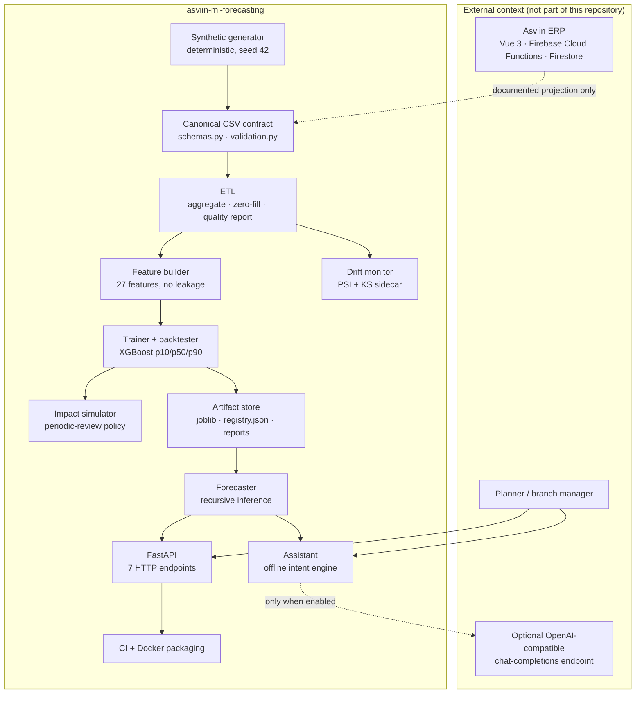
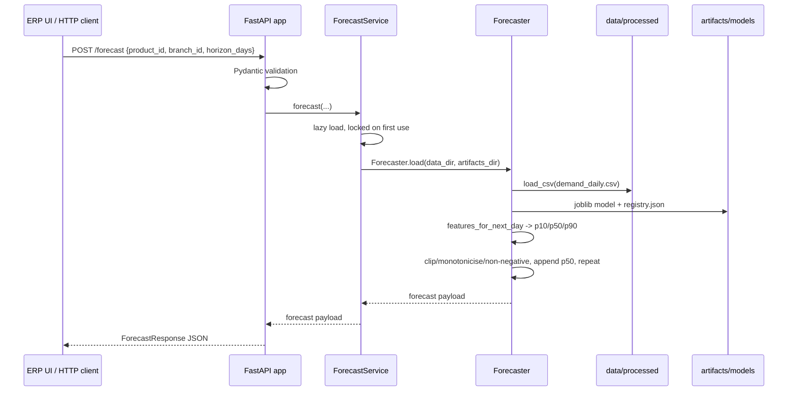

# Architecture — Asviin ML Forecasting

**Scope.** This document describes the implemented architecture of the
`asviin-ml-forecasting` repository: a decoupled AI/MLOps extension of the Asviin ERP. It
covers components, data and control flow, interfaces, failure modes, scaling, operations,
security, observability and the mapping to MLOps practices. It is a design reference, not a
deployment runbook.

**Status.** Reference implementation. The committed dataset and artifacts are 100% synthetic
and are regenerated deterministically from documented seeds. Nothing in this repository
connects to Asviin, Firestore or a production environment.

**Related documents.**

- [`SPEC.md`](SPEC.md) — authoritative interfaces and build contract.
- [`DATA_CONTRACT.md`](DATA_CONTRACT.md) — CSV schema, semantics, versioning and Asviin
  projection.
- [`DECISIONS.md`](DECISIONS.md) — ADR-001 to ADR-008 with context and alternatives.
- [`../README.md`](../README.md) — executive overview, metrics and operating commands.

## 1. Goals and boundaries

The system answers three operational questions:

1. **What demand should we expect?** A probabilistic daily forecast per
   `(business, branch, product)`: p10, p50 and p90 units for a horizon of 1–90 days.
2. **What should we do about it?** A reorder point and reorder quantity derived from that
   forecast, a target service level, the product lead time and the latest stock on hand.
3. **Is the model still trustworthy?** A drift report over the input panel, plus a
   natural-language interface that surfaces the same numbers to a planner.

The boundaries are deliberate:

- **Two integration surfaces only:** a canonical CSV contract for batch data and an HTTP API
  for online predictions. There is no ERP import, no Firestore client, no write-back and no
  shared runtime with Asviin.
- **Synthetic-only public data:** the generator is a deliverable; no client records,
  credentials or personal data are present.
- **Batch training, online serving:** the model is trained offline and loaded by the API from
  immutable files. The API never trains implicitly.
- **Single tenant per dataset:** the processed panel has a `business_id`, but
  `products.csv` does not; the current artifact set represents one business.
- **Non-goals:** replacing the ERP planning module, real-time event ingestion, supplier
  collaboration, multi-echelon optimization, user identity/roles, and a managed model
  registry. Those are future work, not implied capabilities.

## 2. System context



The ERP arrow is **documentation, not an implemented integration**. The mapping from Asviin
v2 collections to CSV is specified in [`DATA_CONTRACT.md`](DATA_CONTRACT.md) §7. A future
export adapter would be read-only, live outside this repository, and emit the same contract.

## 3. Components and responsibilities

| Component | Responsibility | Inputs | Outputs |
|---|---|---|---|
| `src/pipelines/synthetic_generator.py` | Generate a realistic, deterministic raw dataset that exercises the full contract: sales, cancellations, stock movements, pending orders, recipes, promotions, seasonality, trend and stock caps. | Parameters: days, products, branches, seed, start date. | `data/raw/*.csv` + `seed.json`. |
| `src/data_contracts/schemas.py` | Define the canonical Pydantic models, enums, `SCHEMA_VERSION` and exact CSV column order. | Authoritative schema definition. | Models and `CSV_COLUMNS`. |
| `src/data_contracts/validation.py` | Validate headers, required cells, dates, enums, non-negative values, boolean flags, unique keys and foreign keys. | A CSV path and a schema name. | Violation list, `SchemaValidationError` or a validated `DataFrame`. |
| `src/pipelines/etl.py` | Validate raw files, aggregate event lines into the daily grain, zero-fill every product/branch/date, compute stock carry-forward, promo and stockout flags, pending units and the quality report. | `data/raw/`. | `data/processed/demand_daily.csv` + `data_quality.json`. |
| `src/pipelines/features.py` | Build the supervised panel with `y = log1p(units_sold)`, 27 lagged/calendar/inventory features, encoders and the holdout split; expose `features_for_next_day` for serving. | `demand_daily.csv`, holdout days. | Train/validation frames and `meta`; one feature row per inference step. |
| `src/pipelines/train.py` | Train three global XGBoost quantile regressors, score the holdout, compute seasonal-naive and Croston/SBA baselines, write the registry and reports. | Processed panel, `quick` flag. | `xgboost_global.joblib`, `registry.json`, `backtest.json`, `backtest.md`, `impact.json`. |
| `src/pipelines/impact.py` | Simulate a deterministic periodic-review policy for forecast-driven and naive-driven replenishment. | Holdout actuals, p10/p50/p90, naive signal, daily history. | Impact metrics and policy description. |
| `src/pipelines/forecast.py` | Load the daily panel, model and registry; recursively forecast p10/p50/p90; compute the reorder recommendation. | `data/`, `artifacts/`, request parameters. | Dictionary payloads consumed by the API and agent. |
| `src/api/` | Expose a typed HTTP surface, map domain errors to status codes, enforce the optional static key and CORS, count requests. | HTTP requests, `ForecastService`. | JSON responses; process-local metrics. |
| `src/agent/` | Resolve Spanish questions to the forecaster; optionally orchestrate an LLM with local tools; fall back deterministically on any failure. | Question, `Forecaster`, optional LLM endpoint. | `{answer, mode, tool_calls, data}`. |
| `src/monitoring/drift.py` | Compare the last 28-day window with the same calendar window one year earlier (seasonal split, chronological fallback) using PSI and a two-sample KS test. | Processed panel, optional `--inject-drift`. | JSON drift report and a one-line CLI summary. |
| `notebooks/` | Exploratory EDA, modeling and explainability narratives. Optional, not on the serving path. | Processed data and artifacts. | Notebook outputs. |
| `.github/workflows/ci.yml` | Run lint and tests, a quick end-to-end pipeline (data, train, drift, forecaster smoke), build and smoke-test the Docker image, and upload artifacts. | Repository. | CI checks; no deployment. |
| `Dockerfile` | Package the API with the committed synthetic data and artifacts in a non-root runtime image. | Source, data, artifacts. | `asviin-ml-forecasting:local` image. |

## 4. Data and control flow

### 4.1 Batch lineage

```text
synthetic_generator --out data --days 1096 --products 20 --branches 3 --seed 42
  -> data/raw/{products,branches,recipes,economic_events,stock_movements,pending_sales}.csv
  -> data/raw/seed.json                       (parameters only, no timestamps)
  -> etl --raw data/raw --out data/processed/demand_daily.csv
  -> data/processed/data_quality.json         (report, no timestamps)
  -> features.build_supervised(holdout_days=28)
  -> train.train(data, artifacts)
  -> artifacts/models/{xgboost_global.joblib, registry.json}
  -> artifacts/reports/{backtest.json, backtest.md, impact.json}
  -> monitoring.drift --data data/processed/demand_daily.csv
  -> artifacts/monitoring/drift_report.json   (generated on demand)
```

Control rules:

- The ETL is the **only writer** of `data/processed/`. Training is the only writer of
  `artifacts/models/` and `artifacts/reports/`; monitoring is the only writer of
  `artifacts/monitoring/`.
- `docs/SPEC.md` and `src/data_contracts/` are coordinator-owned build inputs. The generator,
  ETL and downstream code must conform to them; they do not redefine the schema.
- `demand_daily.csv` is read through `src.data_contracts.load_csv`, so the validation
  boundary is not bypassed by training, drift, the forecaster or the API.
- No batch step writes back to the ERP. The only online inputs are IDs and scalars; the only
  online outputs are forecast/recommendation payloads.

### 4.2 Online inference



Important behaviors:

- **Lazy load.** Importing `src.api.app` does not read the dataset or the model. The API can
  answer `/health` before artifacts exist. The first model-dependent request triggers the
  load; a lock prevents duplicate loads under concurrency. A successful load is cached for
  the process lifetime.
- **No implicit training.** Missing artifacts produce `503` with an actionable message, not a
  silent training run.
- **Recursive forecasting.** For each horizon step the forecaster builds the next feature row
  from the latest history, predicts the three quantiles, enforces
  `p10 <= p50 <= p90`, appends the p50 as a synthetic day, and repeats. Response values are
  rounded to two decimals. The appended day also depletes `stock_on_hand` by the predicted
  sales, which keeps `stock_to_demand` coherent.
- **Quantile crossing.** The models are trained independently, so the serving and scoring
  paths explicitly order and clip the quantiles. Coverage is reported in the backtest because
  this correction can hide underlying calibration problems.
- **Determinism.** Given the same data, artifacts and request, the numbers are deterministic;
  only `generated_at` changes.

### 4.3 Recommendation logic

`Forecaster.recommend` applies the specification formula on the horizon forecast:

```text
planning_t      = 0.70 * p50_t + 0.30 * p90_t
mu              = mean(planning_t)                       # demand units/day
sigma           = mean((p90_t - p10_t) / 2.562)          # daily uncertainty
z               = Phi^-1(service_level)
safety_stock    = z * sigma * sqrt(lead_time_days)
reorder_point   = mu * lead_time_days + safety_stock
current_stock   = last stock_on_hand in the series
reorder_quantity = max(0, reorder_point - current_stock)
days_of_cover   = current_stock / mu                     # null when mu = 0
```

The 70/30 blend is intentional. The conditional median of a zero-inflated series is often
zero; planning on the p50 alone under-stocks intermittent SKUs. The blend keeps the median's
stability while pricing the upper tail. `2.562` is twice the standard-normal 90th-percentile
value (1.281), i.e. the p10–p90 span of a normal distribution. Lead time comes from the last
product row; it is a fixed master attribute, not a random variable. The policy does not model
supplier constraints, order costs, quantity discounts or stockout costs.

The response exposes `daily_mean` and `sigma` plus explicit `daily_mean_units` and
`sigma_units` aliases, and a `rationale` string that shows every substituted value. Unknown
products/branches raise `KeyError` (mapped to 404); horizons outside 1–90 and service levels
outside `(0, 1)` raise `ValueError` (mapped to 422).

### 4.4 Assistant flow

**Offline mode (default, no network).**

1. Normalize accents, case and whitespace.
2. Detect intent from Spanish stems: recommendation vs forecast.
3. Resolve the product by fuzzy name (`difflib`, cutoff 0.55) plus a unique-token rule.
4. Resolve the branch by id or name; default to the highest-volume branch when the question
   does not mention one and the choice is unambiguous.
5. Extract a horizon in days or weeks and clamp/validate it.
6. Call the same `Forecaster` methods as the API.
7. Compose a concise Spanish answer quoting the returned numbers and model version; include
   a probabilistic caveat.

Missing products produce a clarification that lists candidates; they never raise to the CLI
user.

**LLM mode (only when `OPENAI_API_KEY` is set).**

1. A chat completion request is sent to the configured OpenAI-compatible endpoint with
   `temperature: 0` and three local tool definitions: `list_products`, `forecast` and
   `recommendation`.
2. Tool calls are executed **locally** against the forecaster; results are appended to the
   conversation as tool messages. At most three tool rounds are allowed.
3. On HTTP, parsing, schema or tool-loop failure, the assistant logs a warning and returns
   the offline answer with `mode="offline_fallback"`.
4. Tool results remain the source of truth for numbers; the LLM composes language around them.

There is no conversation memory across CLI invocations.

## 5. Interfaces

### 5.1 Data contract

The executable contract is `src/data_contracts/schemas.py` and
`src/data_contracts/validation.py`; the human-readable contract is
[`DATA_CONTRACT.md`](DATA_CONTRACT.md). `SCHEMA_VERSION` is `1.0.0`.

| File | Grain | Producer | Primary consumers |
|---|---|---|---|
| `data/raw/products.csv` | one product | generator | ETL, features, API catalog |
| `data/raw/branches.csv` | one branch | generator | ETL, API catalog |
| `data/raw/recipes.csv` | one BOM line | generator | contract validation |
| `data/raw/economic_events.csv` | one event line (sale lines are item-level) | generator | ETL |
| `data/raw/stock_movements.csv` | one stock movement | generator | ETL |
| `data/raw/pending_sales.csv` | one pending-sale line | generator | ETL |
| `data/processed/demand_daily.csv` | date × business × branch × product | ETL only | features, training, drift, forecaster |
| `data/processed/data_quality.json` | one report per ETL run | ETL only | operators, CI, reports |

Key semantics: MXN currency, `America/Mexico_City` local calendar days, quantities in each
product's base unit, cancellations excluded from sales but counted separately, pending sales
not added to sales, stock from the movement ledger with forward-fill, and stockouts as
censoring signals. Schema evolution follows the MAJOR/MINOR/PATCH policy in
`DATA_CONTRACT.md` §4; adding a CSV column is a MAJOR change because headers are strict.

### 5.2 Model and artifact contract

```text
artifacts/
├── models/
│   ├── xgboost_global.joblib    # {"models": {"p10", "p50", "p90"}, "meta": {...}}
│   └── registry.json            # champion manifest and metrics
├── reports/
│   ├── backtest.json            # holdout metrics, baselines, per-series sample
│   ├── backtest.md              # generated human-readable report
│   └── impact.json              # periodic-review simulation
└── monitoring/
    └── drift_report.json        # generated by the drift CLI, not committed on every run
```

`registry.json` records the artifact name, training timestamp, holdout length, metrics,
baselines, and a dataset block with the processed CSV path, row/series counts, date range and
SHA-256. `meta` in the joblib payload contains the feature list, categorical encoders,
target transform, random seed and quick/full flag. The forecaster validates the presence of
the three quantile models and the feature metadata; it does **not** re-hash the CSV or verify
a model signature at load time.

The API reports `model_version` from `registry.schema_version` in the current implementation.
Both values are `1.0.0` today; see §11 for the distinction.

### 5.3 HTTP API

The app is created by `create_app(service=None)` in `src/api/app.py`; the module-level `app`
exists for `uvicorn src.api.app:app`. Request and response models live in
`src/api/models.py` and are the HTTP contract.

| Method | Path | Purpose | Success | Domain errors |
|---|---|---|---|---|
| `GET` | `/health` | Liveness; never depends on the model and is always open. | `200 {"status":"ok"}` | — |
| `GET` | `/ready` | Readiness; forces the lazy model load. | `200 {"status":"ready",...}` | `401`, `503` |
| `GET` | `/model` | Champion registry metadata, metrics and dataset lineage. | `200` | `401`, `503` |
| `GET` | `/products?q=` | Product catalog with optional accent-insensitive filter. | `200 {query,count,products}` | `401`, `503` |
| `POST` | `/forecast` | Recursive p10/p50/p90 forecast. | `200 ForecastResponse` | `401`, `404`, `422`, `503` |
| `POST` | `/recommendation` | Reorder point and quantity. | `200 RecommendationResponse` | `401`, `404`, `422`, `503` |
| `GET` | `/metrics` | Per-process request counters and uptime. | `200` | `401` |

Request models are strict (`extra="forbid"`), so a misspelled field fails with 422 instead of
being ignored. `/forecast` accepts `product_id`, `branch_id`, `horizon_days` (1–90, default
28). `/recommendation` accepts those plus `service_level` (strictly between 0 and 1, default
0.95) and defaults `horizon_days` to 30.

Cross-cutting behavior:

- **Authentication.** If `MLFC_API_KEY` is set, every path except `/health` (including
  `/docs` and `/openapi.json`) requires `X-API-Key`. The comparison is constant-time. Browser
  `OPTIONS` preflight requests bypass the key so CORS can operate. Without a configured key,
  every endpoint is open.
- **CORS.** `MLFC_CORS_ORIGINS` is a comma-separated allow-list; the default is `*`.
  Credentials are not allowed. CORS is the outermost middleware so even 401 responses carry
  CORS headers.
- **Errors.** Unknown product/branch → 404 with the known identifiers; invalid payload,
  horizon or service level → 422; missing/unreadable artifacts → 503 with a `make data &&
  make train` hint; missing/wrong key → 401. Error bodies use FastAPI's `{"detail": "..."}`
  shape.
- **Metrics.** Counters are created per app instance and reset on restart. A `/metrics`
  request is counted after its own snapshot is taken.

### 5.4 CLI and Make targets

| Command | Behavior | Writes |
|---|---|---|
| `make data` | Generate the full 1,096-day dataset and run the ETL. | `data/raw/`, `data/processed/` |
| `make data-quick` | Generate a 120-day, 6-product, 2-branch dataset and run the ETL. | `.ci/data/` |
| `make train` | Train the full model and write artifacts/reports. | `artifacts/models/`, `artifacts/reports/` |
| `make train-quick` | Train a quick model on `.ci/data` with 14-day holdout. | `.ci/artifacts/` |
| `make test` | Run the pytest suite. | pytest cache (unless `-p no:cacheprovider`) |
| `make lint` / `make fmt` | Ruff check / Ruff autofix + format on `src` and `tests`. | Possibly source files for `fmt` |
| `make serve` | Run uvicorn on `0.0.0.0:8000`. | — |
| `make monitor` | Run the drift CLI against the processed panel. | `artifacts/monitoring/drift_report.json` |
| `make agent Q="..."` | Ask the assistant a Spanish question. | — |
| `make smoke` | Build quick data and model, then smoke-load the forecaster. | `.ci/` |
| `make docker-build` | Build the serving image. | Local Docker image |
| `make clean` | Remove caches, `.ci/` and `__pycache__`. | Deletes files |

Direct module entry points used by the Makefile:

```bash
.venv/bin/python -m src.pipelines.synthetic_generator --out DIR --days N --products N --branches N --seed N
.venv/bin/python -m src.pipelines.etl --raw DIR --out PATH
.venv/bin/python -m src.pipelines.train --data DIR --artifacts DIR [--quick]
.venv/bin/python -m src.monitoring.drift --data PATH --out PATH [--inject-drift]
.venv/bin/python -m src.agent.cli "QUESTION"
```

### 5.5 Configuration

Settings are read from the process environment in `src/config.py`. Relative data/artifact
paths resolve against the repository root; absolute paths are supported but not required.
There is **no dotenv loader** in this repository, so a `.env` file must be exported/sourced
by the operator (`set -a; source .env; set +a`) rather than merely copied.

| Variable | Default | Effect |
|---|---|---|
| `MLFC_ENV` | `dev` | Stored in settings; not currently consumed by behavior. |
| `MLFC_DATA_DIR` | `data` | Directory containing `processed/` and optional `raw/` metadata. |
| `MLFC_ARTIFACTS_DIR` | `artifacts` | Directory containing `models/` and `reports/`. |
| `MLFC_RANDOM_SEED` | `42` | Random state for training. |
| `MLFC_API_KEY` | unset | Enables the static `X-API-Key` requirement on all non-health endpoints. |
| `MLFC_CORS_ORIGINS` | `*` | Comma-separated allowed origins. |
| `MLFC_MODEL_NAME` | `champion` | Declared in settings; not currently used by the forecaster. |
| `OPENAI_API_KEY` | unset | Enables LLM mode in the agent. |
| `OPENAI_BASE_URL` | `https://api.openai.com/v1` | OpenAI-compatible base URL. |
| `OPENAI_MODEL` | `gpt-4o-mini` | Chat model name. |

## 6. Failure modes and fallbacks

| Failure | Detection | Runtime behavior | Recovery |
|---|---|---|---|
| Missing or malformed raw CSV | `validate_csv` / `validate_referential_integrity` return violations; ETL raises `SchemaValidationError`. | ETL exits non-zero; no processed file is written. | Fix the export or run `make data`; do not coerce rows silently. |
| Not enough history for training | `train` raises `ValueError` when the supervised frame is empty. | Training exits non-zero; existing artifacts remain untouched. | Generate a longer dataset or use `--quick` on the quick dataset. |
| Missing processed data or model at boot | `Forecaster.load` checks file existence. | App starts; `/health` is `200`; model endpoints and `/ready` return `503` with an actionable message. | Run `make data && make train`, or point `MLFC_DATA_DIR`/`MLFC_ARTIFACTS_DIR` at valid artifacts. |
| Corrupt joblib or registry | Load raises `ValueError`/`JSONDecodeError`, wrapped by `ModelUnavailableError`. | `503`; the failed load is not cached, so the next request retries. | Retrain or restore the artifact; no restart strictly required for a retry. |
| Concurrent cold start | `ForecastService` double-checked lock. | One thread loads; concurrent requests wait, then use the cached forecaster. | No action. |
| Unknown product or branch | `_require_series` raises `KeyError`. | `404` with known identifiers. | Call `/products`; use a valid pair. |
| Invalid horizon/service level/extra field | Pydantic or `Forecaster` validation. | `422`; no model work is performed for malformed bodies. | Fix the request. |
| Missing/wrong API key | Auth middleware. | `401` with `WWW-Authenticate: X-API-Key`; `/health` stays open. | Send the header; rotate the key only by restarting/deploying. |
| Drift detected | Drift CLI computes PSI/KS and overall status. | JSON report and one-line summary; no automatic retraining or alert. | Operator reviews feature-level statistics and decides whether to retrain. |
| LLM unavailable, slow or malformed | `_llm_answer` raises; `answer` catches every exception. | Offline deterministic answer with `mode="offline_fallback"`. | No action; unset `OPENAI_API_KEY` to force offline mode. |
| Stale model after retraining | No hot reload; the loaded forecaster is cached. | The process keeps serving the old model. | Deploy a new process/container; `/ready` is the rollout gate. |
| Artifact write failure | Filesystem exception in the CLI. | Command exits non-zero; no silent partial success. | Fix permissions/disk and rerun. |

The system prefers **explicit failure** over fabricated predictions: a missing model is a
503, not a fallback forecast.

## 7. Scaling and operations

**Current scale.** 3 branches × 20 products × 1,096 days = 65,760 rows and 60 series. The
full panel fits comfortably in memory, the model is a single artifact, and training runs on a
CPU. This is deliberately a small, reviewable portfolio system, not a benchmark for
warehouse-scale forecasting.

**Serving.**

- The API is stateless per request apart from the lazily cached forecaster and in-process
  counters. Multiple replicas can run behind a load balancer.
- Each replica pays a cold-start cost: it loads the processed CSV, the joblib model and the
  registry on first use. `/ready` is the correct probe for a rollout; `/health` only proves
  the process is alive.
- Inference cost is O(horizon) Python steps per request, with three tree-model predictions
  per step and no batching. This suits planner-facing traffic; very high throughput would
  require batching, caching or a lower-level serving runtime.
- A new model requires a new process or container because the model is cached after load.
  There is no in-process hot reload.

**Batch.**

- The ETL is linear in event lines plus the zero-filled panel. Training is linear in rows ×
  features per tree ensemble and is deliberately single-threaded (`n_jobs=1`) for
  determinism; the full model uses 300 trees per quantile.
- Data volume growth is handled by the same global-model design: more products/branches add
  rows and series, not model artifacts. Very large panels would need partitioning or a
  different training strategy.
- There is no orchestrator, scheduler or queue in this repository. In production, the
  sequence `generate/export -> ETL -> train -> validate -> deploy` would be an external
  workflow. `make monitor` would be scheduled externally as well.

**Packaging.**

- The Dockerfile uses a two-stage build, installs the wheel, copies the committed synthetic
  data and artifacts, runs as UID 10001 and uses `/health` as its healthcheck. Training does
  not happen during build or start.
- The image is immutable with respect to the model: retraining requires rebuilding the image
  (or mounting updated artifacts, which this Dockerfile does not do).
- CI runs quality, quick-pipeline and Docker build/smoke jobs; it does not deploy or
  publish images. Release engineering is intentionally out of scope.

**Capacity caveats.** The model is trained on one tenant and one catalog. There is no tenant
routing, per-tenant artifact isolation, request quotas or autoscaling configuration. Those
must be added before a shared production deployment.

## 8. Security and privacy

**Data.**

- All committed data is synthetic. There is no client data, no personal information, no
  production backup and no supplier/customer identifier beyond an opaque synthetic
  `customer_id` on credit sales.
- The projection in `DATA_CONTRACT.md` explicitly excludes names, addresses, phone numbers
  and documents. The repository never connects to Firestore.
- `.env` files, credentials and tokens are not committed; `.env.example` contains only
  placeholders. The test suite does not call external services.
- The registry records a SHA-256 for dataset lineage. It is an audit trail, not a signature;
  serving does not verify the hash at load time.

**API.**

- The optional static API key is a coarse access gate. It is compared in constant time and
  sent in `X-API-Key`; `/health` is intentionally open for liveness probes. When a key is
  configured, the docs endpoints are protected too.
- There is **no** identity, authorization, per-user audit, rate limiting, key rotation or
  TLS termination inside the app. A real deployment should put it behind an authenticating
  gateway and terminate TLS there.
- CORS defaults to `*` and allows no credentials. Restrict `MLFC_CORS_ORIGINS` in any shared
  environment.
- Error messages expose known product/branch identifiers to callers who reach the endpoint;
  they do not expose stack traces. The 503 message intentionally includes the configured
  data/artifact directories so an operator can see which mount is wrong.
- `/metrics` is protected only by the same optional key; it contains counters, not data.

**LLM egress.**

- When `OPENAI_API_KEY` is set, the agent sends the user question and the local tool results
  (product metadata, forecast or recommendation numbers) to the configured
  OpenAI-compatible endpoint. With synthetic data this is safe by construction; do not enable
  it with sensitive data without a data-processing review.
- Tool execution stays local. The LLM cannot query Firestore or the ERP through this
  repository; it only receives the results of the three local tools.

**Container.**

- The runtime image is non-root (UID 10001), includes no build tooling in the runtime stage,
  and copies only the application, synthetic data, artifacts and README. It contains no build
  secrets.
- The API does not accept filesystem paths or raw file uploads; inputs are identifiers and
  numeric parameters, which limits path traversal and injection surface.

## 9. Observability

Implemented signals:

- **Liveness:** `GET /health` — process is up, independent of the model and API key.
- **Readiness:** `GET /ready` — model artifacts loaded successfully; `503` otherwise.
- **Model metadata:** `GET /model` — champion, version, training timestamp, dataset lineage,
  metrics and baselines.
- **Counters:** `GET /metrics` — `requests_total`, `forecast_requests`,
  `recommendation_requests`, `errors_total`, `uptime_seconds`; process-local and reset on
  restart.
- **Logs:** standard-library `logging.getLogger(__name__)`; API load events and LLM fallback
  warnings are logged. CLIs print one-line summaries.
- **Batch evidence:** `data_quality.json`, `registry.json` (dataset SHA, timestamps, metrics),
  `backtest.json` / `backtest.md`, `impact.json`, and `drift_report.json` (per-feature PSI,
  KS statistic/p-value, counts, means, window dates and thresholds).

Not implemented:

- structured/JSON logs, request IDs, tracing, prediction logging, dashboards, alert routing,
  Prometheus/OpenTelemetry exporters, or retention policies.
- label-based performance monitoring: the current pipeline has no realized-outcome feed.
- automatic drift alerts or retraining triggers.

A production addition would emit one structured event per inference (IDs, horizon, latency,
model version, status), scrape counters into a metrics backend, alert on `/ready` failures
and error rate, and treat a persistent `drift` status as a ticket rather than an automatic
promotion. Those are recommendations, not current capabilities.

## 10. Mapping to MLOps best practices

| Practice | Implementation in this repository | Evidence | Remaining gap |
|---|---|---|---|
| **Reproducibility** | Deterministic generator, fixed seed, byte-identical raw output, fixed training seed, single-threaded training. | Generator determinism test; `seed.json`; dataset SHA-256. | No container digest pinning or lockfile; timestamps and environment versions are not fully captured. |
| **Contract-first data** | Pydantic models, ordered CSV columns, explicit validators, semantic versioning. | `schemas.py`, `validation.py`, `DATA_CONTRACT.md`. | No automatic consumer-registry; contract changes are coordinated manually. |
| **Evaluation discipline** | Chronological holdout, two mandatory baselines, multiple metrics, interval coverage, per-series sample. | `train.py`, `backtest.json`, `backtest.md`. | One holdout, not rolling-origin; no statistical significance testing. |
| **Baseline honesty** | Seasonal naive and Croston/SBA are reported alongside the champion. | Registry and report tables. | Baselines are point forecasts; coverage is not available for them. |
| **Artifact lineage** | Registry ties model, dataset hash, metrics and timestamps; reports derive from the same predictions. | `registry.json`, `backtest.json`. | Artifact signing, content-addressed storage and promotion metadata are absent. |
| **Versioning** | `SCHEMA_VERSION` for the data contract; `schema_version`/model version for artifacts; git tracks data and artifacts. | `schemas.py`, registry. | Model version and registry schema version are conflated in serving; no independent model build number. |
| **Serving contract** | FastAPI + Pydantic v2, lazy injectable service, OpenAPI, health/readiness, explicit 404/422/503. | `src/api/`. | No versioned API prefix, SLA, rate limiting or request IDs. |
| **Testing** | 103 offline tests across nine modules; API uses injected fixture models; agent tests mock the LLM. | `tests/`, CI. | No load/performance tests, contract tests against a live exporter, or mutation testing. |
| **CI** | GitHub Actions: Ruff, pytest, quick data/train/drift/smoke, artifact upload. | `.github/workflows/ci.yml`. | No Docker build, deployment, security scan or scheduled run. |
| **Monitoring** | PSI + KS sidecar, explicit thresholds, JSON report, chronological split, injected-shift demo. | `drift.py`, drift report. | Univariate, no labels, no alerting, no automatic retraining. |
| **Security and privacy** | Synthetic-only data, no ERP credentials, optional static API key, non-root image, `.env` ignored. | `README`, Dockerfile, config. | No OAuth/RBAC/rate limiting, default `*` CORS, no secret manager. |
| **Documentation and governance** | SPEC, data contract, ADRs, architecture and executive README. | `docs/`, `README.md`. | No model card, risk register or data-retention policy. |
| **Rollback** | Versioned artifacts and immutable container; redeploy the previous image. | Registry + Dockerfile. | No automated promotion, canary or rollback workflow. |

## 11. Known gaps and inconsistencies

These are observed in the current tree and are reported rather than silently corrected,
because the affected files are outside this document's ownership or would require a product
decision:

1. **Missing ADR-009.** `src/pipelines/forecast.py` refers to "ADR-009" for the 70/30
   planning blend, but `docs/DECISIONS.md` contains only ADR-001 to ADR-008. The decision is
   documented in `impact.py` and in §4.3; the ADR record is absent.
2. **Unused settings.** `MLFC_MODEL_NAME` and `MLFC_ENV` are parsed into `Settings` but are
   not consumed by the forecaster or API. `.env.example` describes `MLFC_MODEL_NAME` as
   resolving the champion, which is not currently true.
3. **No dotenv loading.** `.env.example` says to copy it to `.env`, but the code reads only
   `os.getenv` and there is no dotenv dependency. Operators must export/source the file.
4. **`scipy` is an implicit dependency.** `drift.py` imports `scipy.stats`, but `pyproject.toml`
   does not declare `scipy` directly; it is installed transitively via scikit-learn. A direct
   dependency would make the monitoring contract explicit.
5. **Model version conflation.** `Forecaster.model_version` falls back to
   `registry["schema_version"]`; the registry has no separate model version field. Both are
   `1.0.0` today, but the concepts are intended to evolve independently.
6. **Drift status on the committed panel.** `make monitor` reports `drift` because the KS
   test is extremely sensitive at 46,020 reference and 19,740 current rows; for `units_sold`,
   PSI is 0.008 while the KS p-value rounds to 0.0. This is a calibration/threshold gap, not
   evidence that the dataset is broken. The report is a diagnostic, not an automatic action.
7. **Coverage shortfall.** The 90% interval covers 83.75% of holdout actuals, below nominal 90%.
   The serving and scoring paths enforce non-crossing quantiles, which can mask calibration
   error; rolling-origin calibration is the recommended next step.
8. **Fuzzy product resolution.** "hojuela de PET" resolves to *Hojuela de PEAD reciclado*
   (P-003) rather than *Hojuela de PET reciclado transparente* (P-002). The agent is
   deterministic but can choose a near name; API callers should use product IDs for
   precision.

## 12. References

- [`SPEC.md`](SPEC.md) — §4 defines the public module APIs; §5 defines the registry shape;
  §6–§7 define coding standards and testing requirements.
- [`DATA_CONTRACT.md`](DATA_CONTRACT.md) — §4 versioning, §6 data dictionary, §7 Asviin
  projection, §8 validation boundary.
- [`DECISIONS.md`](DECISIONS.md) — ADR-001 through ADR-008.
- [`../artifacts/models/registry.json`](../artifacts/models/registry.json) — champion
  manifest and metrics.
- [`../artifacts/reports/backtest.json`](../artifacts/reports/backtest.json),
  [`../artifacts/reports/impact.json`](../artifacts/reports/impact.json) — evaluation and
  simulation evidence.
- [`../README.md`](../README.md) — results, quickstart, API examples and limitations.
